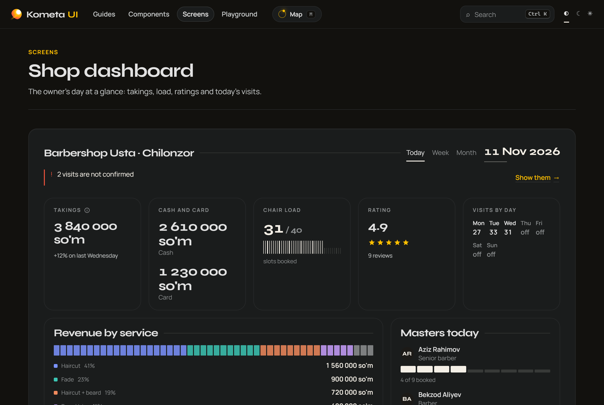
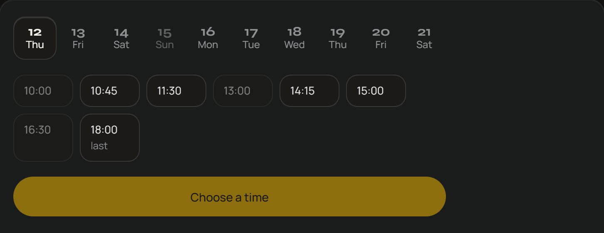
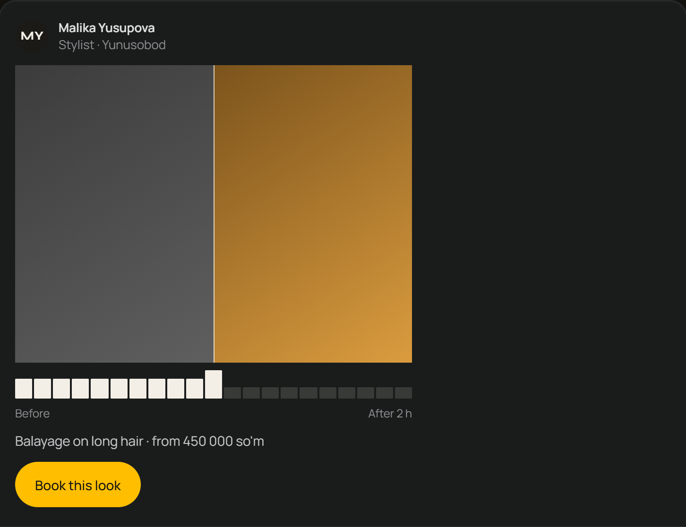
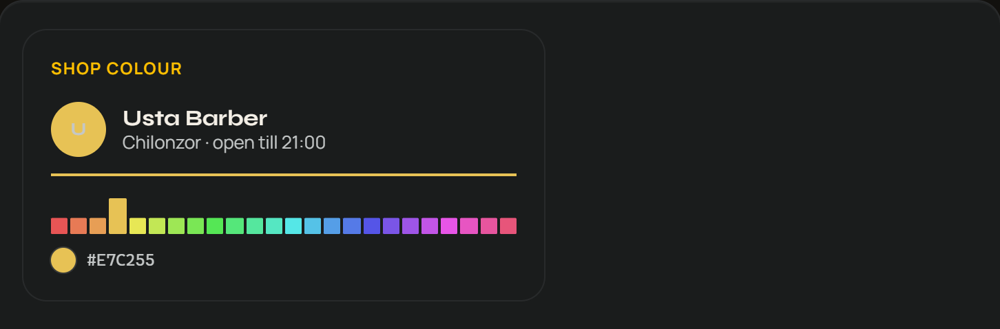
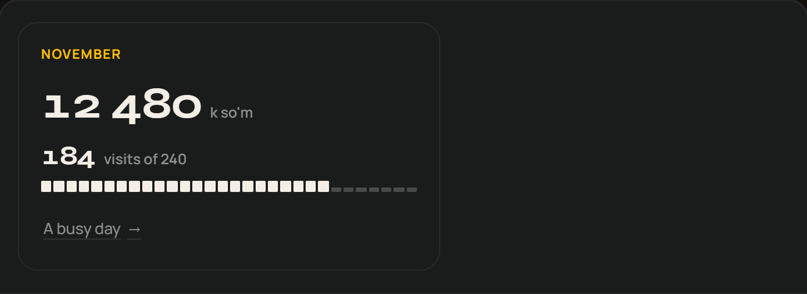
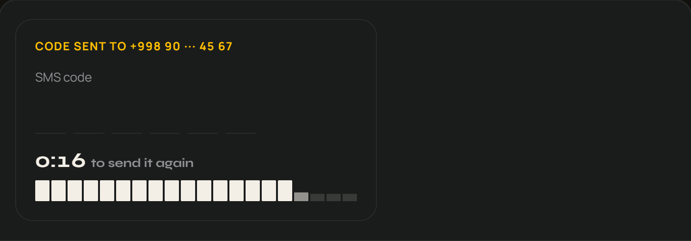
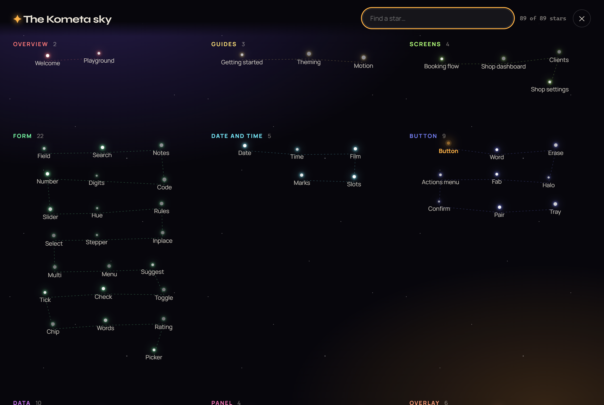

# Kometa UI

A dense, warm UI kit for Angular 22: standalone, OnPush components, light and dark from one set of
CSS custom properties, no third-party UI dependency.

**[Live demo and docs](https://inomjonismaylov.github.io/kometa-ui-kit/)**



## A few highlights

<table>
<tr>
<td width="50%" valign="top">

**[`k-film` + `k-slots`](https://inomjonismaylov.github.io/kometa-ui-kit/#slots/in-context)**: a week strip with a glass thumb that slides behind the chosen day, and bookable times as glass chips.



```html
<k-film [days]="days" [(value)]="day" ariaLabel="Day" />
<k-slots [slots]="slots()" [(value)]="time" ariaLabel="Time" />
```

</td>
<td width="50%" valign="top">

**[`k-reveal`](https://inomjonismaylov.github.io/kometa-ui-kit/#reveal/in-context)**: before and after in one frame, scrubbed along a row of ticks by drag or arrow keys.



```html
<k-reveal [before]="before" [after]="after"
          aspectRatio="4/3" ariaLabel="Before and after" />
```

</td>
</tr>
<tr>
<td valign="top">

**[`k-hue`](https://inomjonismaylov.github.io/kometa-ui-kit/#hue/in-context)**: a colour picked from a row of hue ticks, each drawn in its own hue; saturation and lightness stay fixed so every pick fits one family.



```html
<k-hue [(value)]="brand" ariaLabel="Shop colour" />
```

</td>
<td valign="top">

**[`k-tally`](https://inomjonismaylov.github.io/kometa-ui-kit/#tally/in-context)**: a figure that counts up to its new value, with ticks that fill toward `max`. A screen reader hears only the final value.



```html
<k-tally [value]="visits()" [max]="240" unit="visits of 240" />
```

</td>
</tr>
<tr>
<td valign="top">

**[`k-countdown`](https://inomjonismaylov.github.io/kometa-ui-kit/#countdown/in-context)**: time running out as ticks that drain one by one; `(done)` fires at zero.



```html
<k-countdown [duration]="20" label="to send it again"
             (done)="canResend.set(true)" />
```

</td>
<td valign="top">

**[`k-swipe`](https://inomjonismaylov.github.io/kometa-ui-kit/#swipe)**: pull a row right and ticks fill until it is done; pull left and a ring grows and turns red. Both actions are also buttons reached with Tab.

```html
<k-swipe rightLabel="Done" leftLabel="Cancel visit"
         (swipedRight)="done(v)" (swipedLeft)="cancel(v)">
  …
</k-swipe>
```

Also worth a look: `[kAnimate]` motion presets, `button[k-halo]`,
`k-tick`, `k-digits`, and the four full [Screens](https://inomjonismaylov.github.io/kometa-ui-kit/#booking).

</td>
</tr>
</table>

The docs site has no sidebar: press <kbd>M</kbd> for the constellation map of every page, or <kbd>Ctrl</kbd>+<kbd>K</kbd> to search.



## Use it

```ts
// app.config.ts
import { provideKometaUi } from 'kometa-ui';

export const appConfig = { providers: [provideKometaUi()] };
```

```scss
// styles.scss: the layer order must come first
@use 'kometa-ui/styles/layers';
@use 'kometa-ui/styles/base';
```

```html
<k-button label="Save" (clicked)="save()" />
```

Components use the `k-` prefix (`<k-button>`, `<k-drawer>`, `button[k-halo]`) and read their colours
from tokens such as `--amber`, `--bg` and `--text`, so overriding a token on any element restyles
everything inside it.

## Using it with AI agents

The package ships a guide written for coding agents, `ai/usage.md`, and a generated reference of every
component's selector, inputs, outputs and defaults, `ai/components.md`. Point your agent at them by adding
a line to your project's `AGENTS.md` (or `CLAUDE.md`):

```md
UI components come from kometa-ui: read node_modules/kometa-ui/ai/usage.md before writing UI code,
and node_modules/kometa-ui/ai/components.md for a component's inputs and outputs.
```

Claude Code can pull the guide straight in with `@node_modules/kometa-ui/ai/usage.md`. Tools that read the
web can use [llms.txt](https://inomjonismaylov.github.io/kometa-ui-kit/llms.txt) and
[llms-full.txt](https://inomjonismaylov.github.io/kometa-ui-kit/llms-full.txt).

## Develop

```bash
npm install
npm start          # demo at http://localhost:4200
npm test           # library specs (vitest)
npm run build      # library into dist/kometa-ui
```

The repo holds two projects: `projects/kometa-ui` (the library) and `projects/demo` (the docs site,
which imports the library from source). Every push to `main` deploys the demo to GitHub Pages.

## License

[MIT](LICENSE). The bundled Manrope and Syne fonts are under the
[SIL Open Font License 1.1](projects/kometa-ui/styles/fonts/OFL.txt).
