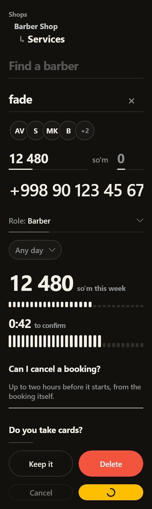
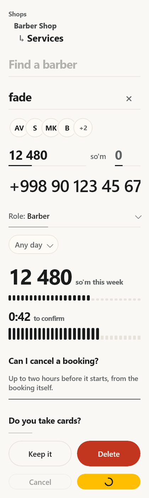
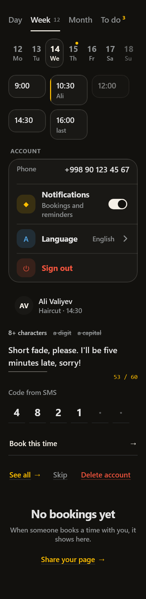
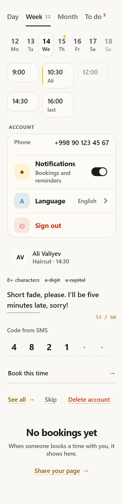

# kometa-ui for Compose Multiplatform

The Kometa design tokens and a core set of components for Jetpack Compose / Compose Multiplatform
(Android, desktop JVM, iOS). Built on `compose.foundation` only, with no Material dependency, the
same way the web kit has no PrimeNG.

| Dark | Light |
|---|---|
|  |  |
|  |  |
|  |  |
|  |  |
|  |  |

## Use it in an Android project

The kit is published to GitHub Packages. GitHub asks for a token even to download a public
package, so create a classic personal access token with only the `read:packages` scope
(github.com → Settings → Developer settings → Personal access tokens) and put it in
`~/.gradle/gradle.properties`, never in the project:

```properties
gpr.user=<your GitHub username>
gpr.key=<the token>
```

Then in the app:

```kotlin
// settings.gradle.kts
dependencyResolutionManagement {
    repositories {
        google()
        mavenCentral()
        maven("https://maven.pkg.github.com/InomjonIsmaylov/kometa-ui-kit") {
            credentials {
                username = providers.gradleProperty("gpr.user").orNull ?: System.getenv("GITHUB_ACTOR")
                password = providers.gradleProperty("gpr.key").orNull ?: System.getenv("GITHUB_TOKEN")
            }
        }
    }
}

// app/build.gradle.kts
dependencies { implementation("uz.kometa:kometa-ui:0.2.0") }
```

In GitHub Actions the `GITHUB_ACTOR` / `GITHUB_TOKEN` fallback works once the workflow has
`permissions: packages: read` (and, for a repository other than this one, the package's
"Manage Actions access" setting lists it).

To try a change before releasing it, `./gradlew :kometa-ui:publishToMavenLocal` and put
`mavenLocal()` first in the app's repositories.

```kotlin
setContent {
    KometaTheme {                       // follows the system light/dark; pass dark = true to force it
        Column(Modifier.background(Kometa.colors.bg)) {
            BasicText("Bookings", style = Kometa.type.title.copy(color = Kometa.colors.text))
            KometaButton("Book now", onClick = { /* ... */ }, Modifier.fillMaxWidth())
        }
    }
}
```

### Fonts

The web kit ships Manrope and Syne as `.woff2`, which Compose cannot load. Put the `.ttf` files in
your app's `res/font` and pass them in:

```kotlin
KometaTheme(fonts = KometaFonts(
    sans = FontFamily(Font(R.font.manrope_medium, FontWeight.Medium), Font(R.font.manrope_bold, FontWeight.Bold)),
    display = FontFamily(Font(R.font.syne_bold, FontWeight.Bold)),
)) { ... }
```

Without them the system sans and mono are used.

## What's in it

| Compose | Web | |
|---|---|---|
| `KometaTheme`, `Kometa.colors` / `.type` / `.fonts` | `styles/tokens.scss` | Every colour token in both schemes |
| `KometaButton` | `k-button` | `severity`, `variant` (Filled/Outlined/Text), `small`, `loading`, `icon` |
| `KometaTag` | `k-tag` | Dot and word |
| `KometaBanner` | `k-banner` | Hairline notice, action word, dismiss |
| `KometaBadge` | `k-badge` | Count disc that pops on change |
| `KometaChip` | `k-chip` | Multi-select glass pill |
| `KometaCheck` | `k-check` | Strike-through checkbox |
| `KometaToggle` | `k-toggle` | Word switch, or track and knob with no words |
| `KometaField` | `k-field` | The "whisper" text field |
| `KometaStepper` | `k-stepper` | Number between two circles |
| `KometaTick` | `k-tick` | Ring checkbox with no label of its own |
| `KometaRating` | `k-rating` | Numerals radio group with a word per score |
| `KometaSlider` | `k-slider` | Drag along a row of ticks |
| `KometaMeter` | `k-meter` | Read-only figure over ticks |
| `KometaStars` | `k-stars` | Read-only score, half stars |
| `KometaHeading` | `k-heading` | Title, hairline, optional action |
| `KometaPerson` | `k-person` | Initials disc or photo, name and meta; the avatar |
| `KometaFold`, `KometaFoldMark` | `k-fold` | Disclosure |
| `KometaSteps` | `k-steps` | Progress rail with a travelling bead |
| `KometaSkeleton` | `k-skeleton` | Hairline loading rows, card or single line |
| `KometaWait` | `k-wait` | Label with a travelling line |
| `KometaTabbar` | `k-tabbar` | Glass capsule of icon tabs |
| `KometaToasts` | `k-toast` | Draining glass pills; place over the screen |
| `KometaDrawer` | `k-drawer` | Bottom sheet or side panel over a dimmed screen; Back closes it |
| `KometaSelect` | `k-select` | One choice from a list that drops below the field, or above when there is no room; `pill` for a toolbar |
| `KometaSearch` | `k-search` | The question is the type; a "×" once there is text, `large` hero |
| `KometaNumber` | `k-number` | Whole number, `null` when empty, held in `min`..`max`; `money` groups in threes |
| `KometaDigits` | `k-digits` | `+998` national number, stored as 9 digits, shown `90 123 45 67` |
| `KometaAccordionItem` | `k-accordion` | Question and answer; hold the open index for one at a time |
| `KometaCrumbs` | `k-crumbs` | Path that walks down the page to the current title |
| `KometaAvatars` | `k-avatars` | Overlapping discs and a "+N" |
| `KometaPair` | `k-pair` | Keep / delete footer of a destructive confirm; `busy` locks both |
| `KometaTally` | `k-tally` | Figure that counts to its new value, optional ticks |
| `KometaCountdown` | `k-countdown` | "0:42" over ticks that drain; `onDone` at zero |
| `KometaWords`, `KometaWordOption` | `k-words` | A few words with a sliding cream line; `tabs` for panel tabs |
| `KometaFilm`, `KometaFilmDay` | `k-film` | Week strip with a glass thumb behind the chosen day |
| `KometaSlots`, `KometaSlot` | `k-slots` | Time slot chips, amber edge on the chosen one |
| `KometaRows`, `KometaRow`, `KometaRowValue` | `k-rows`, `k-row` | Glass settings panel; fact rows and setting rows with tinted icon tiles |
| `KometaSwipe` | `k-swipe` | Swipe right over ticks, left past a red ring; both also screen-reader actions |
| `KometaRules`, `KometaRule` | `k-rules` | Password rules that strike themselves out |
| `KometaNotes` | `k-notes` | Multi-line text that grows; count in the last 30 characters |
| `KometaCode` | `k-code` | One cell per digit; typing and pasting as in one field |
| `KometaWord` | `k-word` | Underlined action word with an arrow; `lead` row, `busy` dash |
| `KometaErase` | `k-erase` | Red destructive word |
| `KometaQuiet` | `k-quiet` | Centred empty state, title and hint |

State is hoisted the Compose way: every control takes its value and an `on…Change` callback.
Icons are composable slots drawn in `LocalKometaContentColor`, so any icon set works.

Not ported yet: date, time, picker, multi-select and suggest, table and rows, menus and popovers,
carousel, photos, upload, tree, reorder, split/panes and the remaining web-only helpers. Not
carried over from the ported ones: `k-number`'s minus/plus circles (use `KometaStepper`),
`k-select` groups, and keyboard arrows in the accordion and select lists.

## Develop

```bash
./gradlew :kometa-ui:assembleRelease   # Android AAR
./gradlew :kometa-ui:desktopTest       # logic and select tests, and renders build/gallery*-{dark,light}.png
```

iOS targets are declared but only build on a Mac.

## Release

1. Set `version` in `kometa-ui/build.gradle.kts` (GitHub Packages will not overwrite a published version).
2. Commit and push `main`.
3. Tag that commit `compose-v<version>` and push the tag. `.github/workflows/publish-compose.yml` checks the
   tag against the version, runs `desktopTest` on macOS (needed for the iOS artifacts) and publishes.
