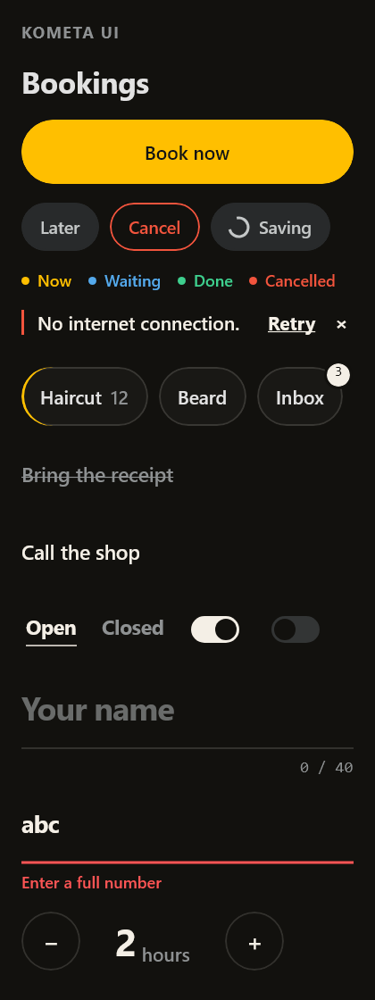
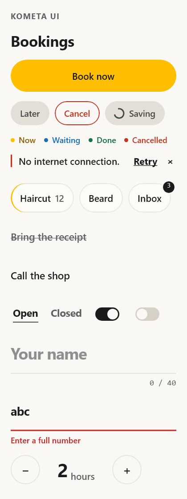
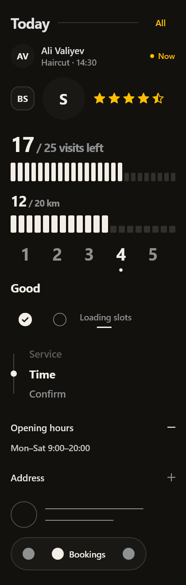
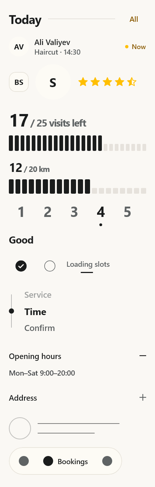
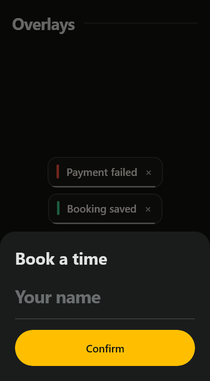
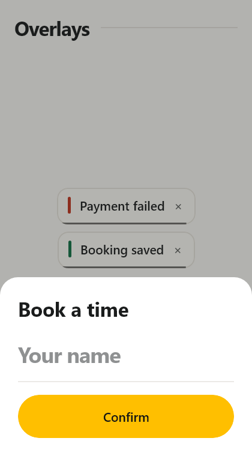

# kometa-ui for Compose Multiplatform

The Kometa design tokens and a core set of components for Jetpack Compose / Compose Multiplatform
(Android, desktop JVM, iOS). Built on `compose.foundation` only, with no Material dependency, the
same way the web kit has no PrimeNG.

| Dark | Light |
|---|---|
|  |  |
|  |  |
|  |  |

## Use it in an Android project

Publish to your local Maven repository:

```bash
./gradlew :kometa-ui:publishToMavenLocal
```

Then in the app:

```kotlin
// settings.gradle.kts
dependencyResolutionManagement { repositories { mavenLocal(); google(); mavenCentral() } }

// app/build.gradle.kts
dependencies { implementation("uz.kometa:kometa-ui:0.1.0") }
```

```kotlin
setContent {
    KometaTheme {                       // follows the system light/dark; pass dark = true to force it
        Column(Modifier.background(Kometa.colors.bg)) {
            BasicText("Bookings", style = Kometa.type.title.copy(color = Kometa.colors.text))
            KometaButton("Book now", onClick = { /* ... */ }, Modifier.fillMaxWidth())
        }
    }
}
```

### Fonts

The web kit ships Manrope and Syne as `.woff2`, which Compose cannot load. Put the `.ttf` files in
your app's `res/font` and pass them in:

```kotlin
KometaTheme(fonts = KometaFonts(
    sans = FontFamily(Font(R.font.manrope_medium, FontWeight.Medium), Font(R.font.manrope_bold, FontWeight.Bold)),
    display = FontFamily(Font(R.font.syne_bold, FontWeight.Bold)),
)) { ... }
```

Without them the system sans and mono are used.

## What's in it

| Compose | Web | |
|---|---|---|
| `KometaTheme`, `Kometa.colors` / `.type` / `.fonts` | `styles/tokens.scss` | Every colour token in both schemes |
| `KometaButton` | `k-button` | `severity`, `variant` (Filled/Outlined/Text), `small`, `loading`, `icon` |
| `KometaTag` | `k-tag` | Dot and word |
| `KometaBanner` | `k-banner` | Hairline notice, action word, dismiss |
| `KometaBadge` | `k-badge` | Count disc that pops on change |
| `KometaChip` | `k-chip` | Multi-select glass pill |
| `KometaCheck` | `k-check` | Strike-through checkbox |
| `KometaToggle` | `k-toggle` | Word switch, or track and knob with no words |
| `KometaField` | `k-field` | The "whisper" text field |
| `KometaStepper` | `k-stepper` | Number between two circles |
| `KometaTick` | `k-tick` | Ring checkbox with no label of its own |
| `KometaRating` | `k-rating` | Numerals radio group with a word per score |
| `KometaSlider` | `k-slider` | Drag along a row of ticks |
| `KometaMeter` | `k-meter` | Read-only figure over ticks |
| `KometaStars` | `k-stars` | Read-only score, half stars |
| `KometaHeading` | `k-heading` | Title, hairline, optional action |
| `KometaPerson` | `k-person` | Initials disc or photo, name and meta; the avatar |
| `KometaFold`, `KometaFoldMark` | `k-fold` | Disclosure |
| `KometaSteps` | `k-steps` | Progress rail with a travelling bead |
| `KometaSkeleton` | `k-skeleton` | Hairline loading rows, card or single line |
| `KometaWait` | `k-wait` | Label with a travelling line |
| `KometaTabbar` | `k-tabbar` | Glass capsule of icon tabs |
| `KometaToasts` | `k-toast` | Draining glass pills; place over the screen |
| `KometaDrawer` | `k-drawer` | Bottom sheet or side panel over a dimmed screen; Back closes it |

State is hoisted the Compose way: every control takes its value and an `on…Change` callback.
Icons are composable slots drawn in `LocalKometaContentColor`, so any icon set works.

Not ported yet: the date/time/picker/select family, table and rows, menus and popovers, carousel,
photos, upload, tree, reorder, split/panes and the remaining web-only helpers.

## Develop

```bash
./gradlew :kometa-ui:assembleRelease   # Android AAR
./gradlew :kometa-ui:desktopTest       # logic tests, and renders build/gallery*-{dark,light}.png
```

iOS targets are declared but only build on a Mac.
