# kometa-ui for Compose Multiplatform

The Kometa design tokens and a core set of components for Jetpack Compose / Compose Multiplatform
(Android, desktop JVM, iOS, web via Wasm). **[Run it live in the browser](https://inomjonismaylov.github.io/kometa-ui-kit/#compose)**. Built on `compose.foundation` only, with no Material dependency, the
same way the web kit has no PrimeNG.

| Dark | Light |
|---|---|
| 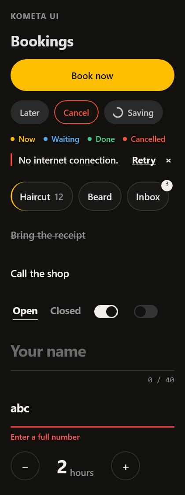 | 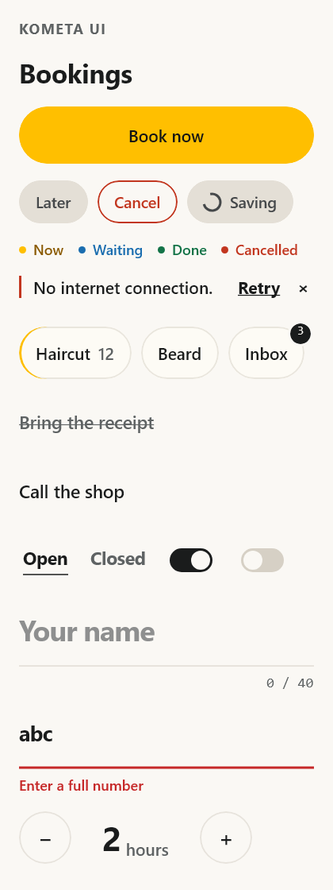 |
| 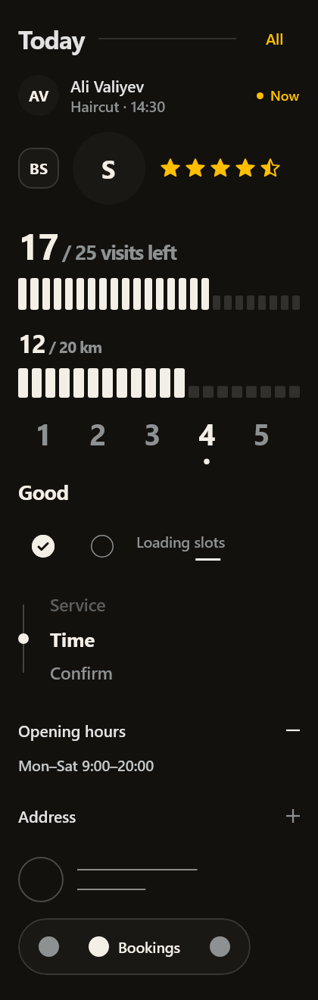 | 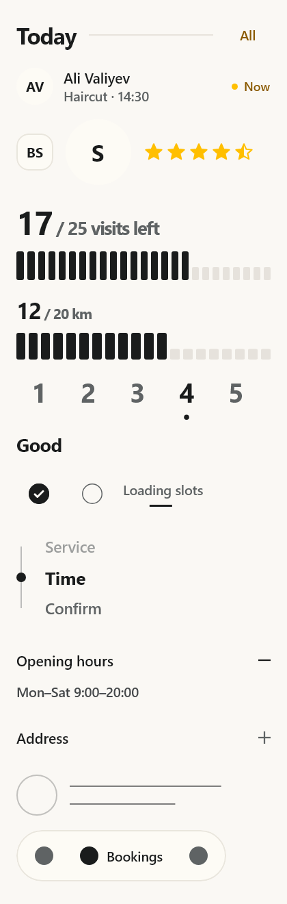 |
| 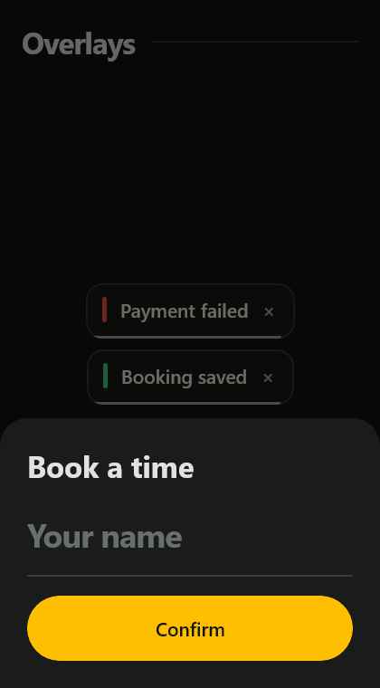 | 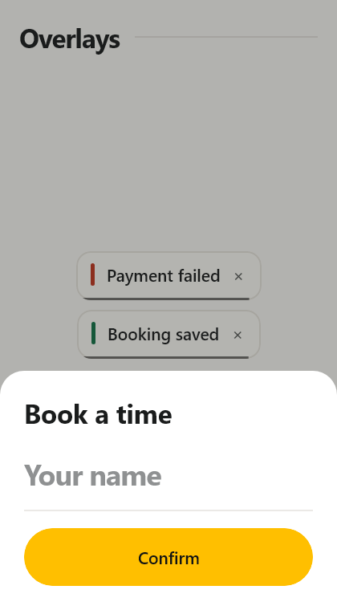 |
| 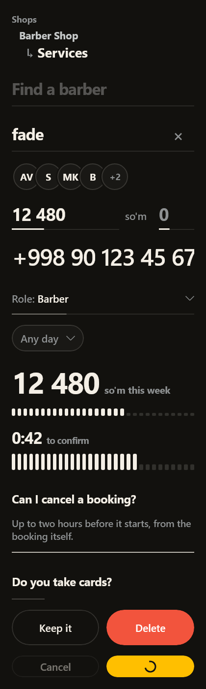 | 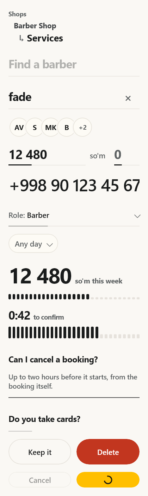 |
| 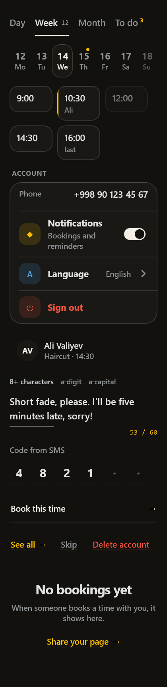 | 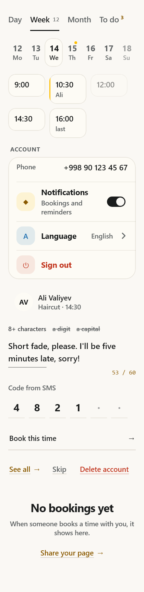 |
| 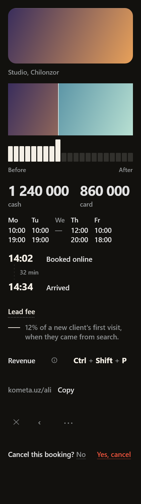 | 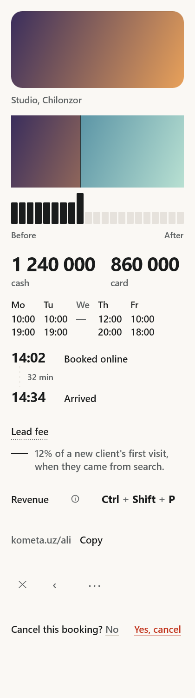 |
| 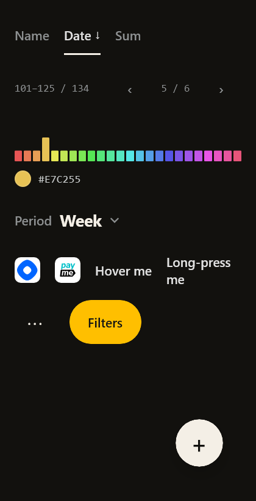 | 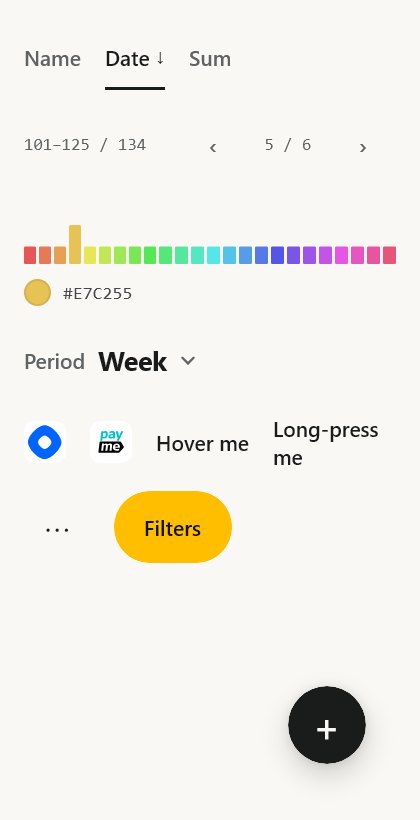 |
| 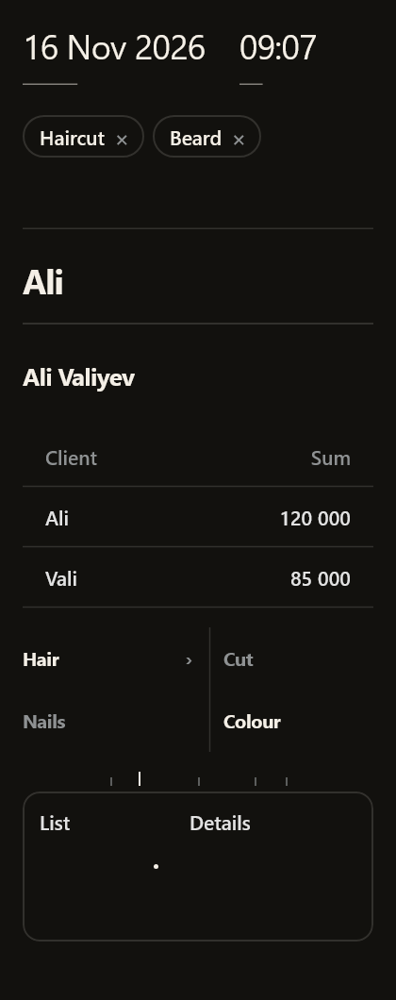 | 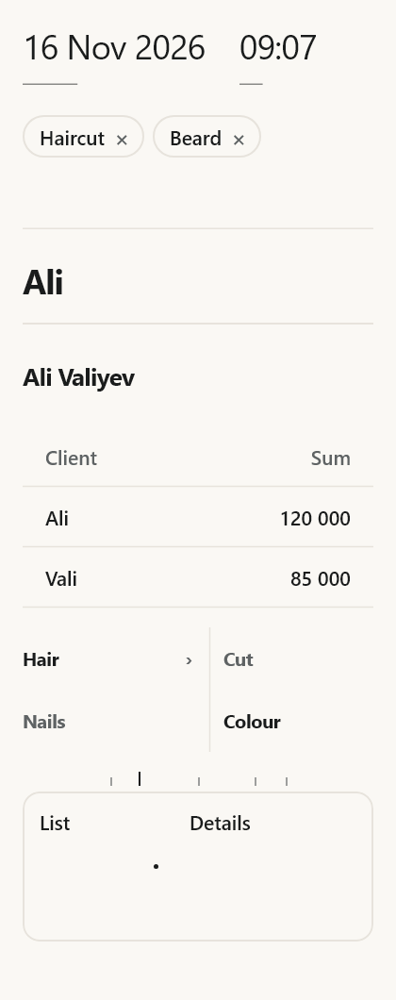 |
| 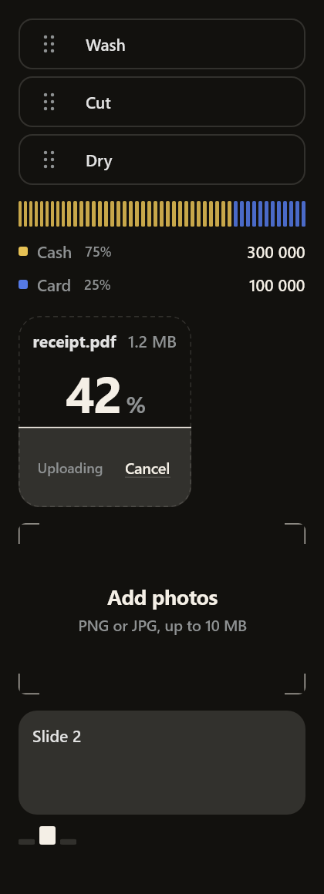 | 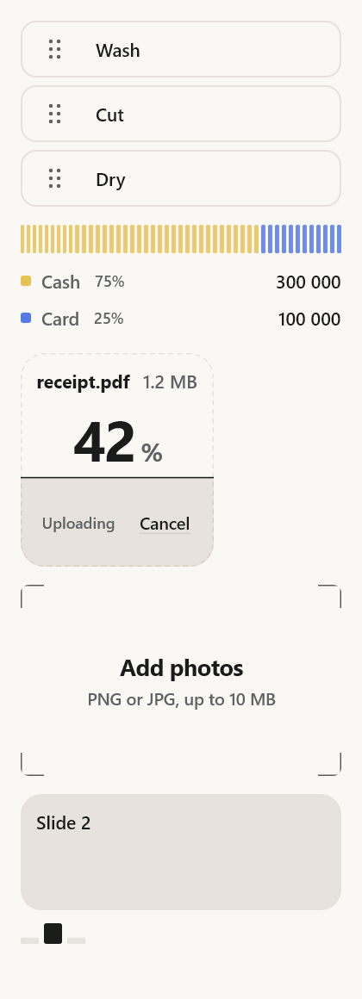 |

## Use it in an Android project

The kit is on Maven Central (signed, with sources and a Dokka javadoc jar), so no extra repository or token:

```kotlin
// app/build.gradle.kts
dependencies { implementation("io.github.inomjonismaylov:kometa-ui:0.4.0") }
```

The Kotlin package is still `uz.kometa.ui`. Versions up to 0.3.0 were published to GitHub Packages as
`uz.kometa:kometa-ui`; moving to 0.4.0 changes only the dependency line.

Requirements: Kotlin 2.2+, Compose Multiplatform 1.11+ (Jetpack Compose 1.11+), Android Gradle plugin 8.6+ with
compileSdk 35+, minSdk 24, desktop on Java 17+. These floors are kept low on purpose so an app does not have to
upgrade its toolchain to adopt the kit. Targets: Android, desktop JVM, iosArm64, iosSimulatorArm64 and wasmJs
(no iosX64: Intel-Mac simulators, which Compose Multiplatform drops in 1.12).

### Translating the built-in words

The words the kit says on its own (screen-reader names, pager and reorder labels, month names) are in
`KometaStrings`. Pass a translated copy once, instead of a label at every call:

```kotlin
KometaTheme(strings = KometaStrings(remove = "Olib tashlash", previousPage = "Oldingi sahifa")) { App() }
```

A label passed to a component still wins.

In GitHub Actions the `GITHUB_ACTOR` / `GITHUB_TOKEN` fallback works once the workflow has
`permissions: packages: read` (and, for a repository other than this one, the package's
"Manage Actions access" setting lists it).

To try a change before releasing it, `./gradlew :kometa-ui:publishToMavenLocal` and put
`mavenLocal()` first in the app's repositories.

```kotlin
setContent {
    KometaTheme {                       // follows the system light/dark; pass dark = true to force it
        Column(Modifier.background(Kometa.colors.bg)) {
            BasicText("Bookings", style = Kometa.type.title.copy(color = Kometa.colors.text))
            KometaButton("Book now", onClick = { /* ... */ }, Modifier.fillMaxWidth())
        }
    }
}
```

### Fonts

The web kit ships Manrope and Syne as `.woff2`, which Compose cannot load. Put the `.ttf` files in
your app's `res/font` and pass them in:

```kotlin
KometaTheme(fonts = KometaFonts(
    sans = FontFamily(Font(R.font.manrope_medium, FontWeight.Medium), Font(R.font.manrope_bold, FontWeight.Bold)),
    display = FontFamily(Font(R.font.syne_bold, FontWeight.Bold)),
)) { ... }
```

Without them the system sans and mono are used.

## What's in it

| Compose | Web | |
|---|---|---|
| `KometaTheme`, `Kometa.colors` / `.type` / `.fonts` | `styles/tokens.scss` | Every colour token in both schemes |
| `KometaButton` | `k-button` | `severity`, `variant` (Filled/Outlined/Text), `small`, `loading`, `icon` |
| `KometaTag` | `k-tag` | Dot and word |
| `KometaBanner` | `k-banner` | Hairline notice, action word, dismiss |
| `KometaBadge` | `k-badge` | Count disc that pops on change |
| `KometaChip` | `k-chip` | Multi-select glass pill |
| `KometaCheck` | `k-check` | Strike-through checkbox |
| `KometaToggle` | `k-toggle` | Word switch, or track and knob with no words |
| `KometaField` | `k-field` | The "whisper" text field |
| `KometaStepper` | `k-stepper` | Number between two circles |
| `KometaTick` | `k-tick` | Ring checkbox with no label of its own |
| `KometaRating` | `k-rating` | Numerals radio group with a word per score |
| `KometaSlider` | `k-slider` | Drag along a row of ticks |
| `KometaMeter` | `k-meter` | Read-only figure over ticks |
| `KometaStars` | `k-stars` | Read-only score, half stars |
| `KometaHeading` | `k-heading` | Title, hairline, optional action |
| `KometaPerson` | `k-person` | Initials disc or photo, name and meta; the avatar |
| `KometaFold`, `KometaFoldMark` | `k-fold` | Disclosure |
| `KometaSteps` | `k-steps` | Progress rail with a travelling bead |
| `KometaSkeleton` | `k-skeleton` | Hairline loading rows, card or single line |
| `KometaWait` | `k-wait` | Label with a travelling line |
| `KometaTabbar` | `k-tabbar` | Glass capsule of icon tabs |
| `KometaToasts` | `k-toast` | Draining glass pills; place over the screen |
| `KometaDrawer` | `k-drawer` | Bottom sheet or side panel over a dimmed screen; Back closes it |
| `KometaSelect` | `k-select` | One choice from a list that drops below the field, or above when there is no room; `pill` for a toolbar |
| `KometaSearch` | `k-search` | The question is the type; a "×" once there is text, `large` hero |
| `KometaNumber` | `k-number` | Whole number, `null` when empty, held in `min`..`max`; `money` groups in threes |
| `KometaDigits` | `k-digits` | `+998` national number, stored as 9 digits, shown `90 123 45 67` |
| `KometaAccordionItem` | `k-accordion` | Question and answer; hold the open index for one at a time |
| `KometaCrumbs` | `k-crumbs` | Path that walks down the page to the current title |
| `KometaAvatars` | `k-avatars` | Overlapping discs and a "+N" |
| `KometaPair` | `k-pair` | Keep / delete footer of a destructive confirm; `busy` locks both |
| `KometaTally` | `k-tally` | Figure that counts to its new value, optional ticks |
| `KometaCountdown` | `k-countdown` | "0:42" over ticks that drain; `onDone` at zero |
| `KometaWords`, `KometaWordOption` | `k-words` | A few words with a sliding cream line; `tabs` for panel tabs |
| `KometaFilm`, `KometaFilmDay` | `k-film` | Week strip with a glass thumb behind the chosen day |
| `KometaSlots`, `KometaSlot` | `k-slots` | Time slot chips, amber edge on the chosen one |
| `KometaRows`, `KometaRow`, `KometaRowValue` | `k-rows`, `k-row` | Glass settings panel; fact rows and setting rows with tinted icon tiles |
| `KometaSwipe` | `k-swipe` | Swipe right over ticks, left past a red ring; both also screen-reader actions |
| `KometaRules`, `KometaRule` | `k-rules` | Password rules that strike themselves out |
| `KometaNotes` | `k-notes` | Multi-line text that grows; count in the last 30 characters |
| `KometaCode` | `k-code` | One cell per digit; typing and pasting as in one field |
| `KometaWord` | `k-word` | Underlined action word with an arrow; `lead` row, `busy` dash |
| `KometaErase` | `k-erase` | Red destructive word |
| `KometaQuiet` | `k-quiet` | Centred empty state, title and hint |
| `KometaFrame` | `k-frame` | Glass picture frame with a lit top edge and a caption |
| `KometaReveal` | `k-reveal` | Before / after in one frame, dragged along a row of ticks; a slider for screen readers |
| `KometaSplit`, `KometaSplitSide` | `k-split` | Two display figures side by side; the second wraps when they do not fit |
| `KometaMarks`, `KometaMarkDay` | `k-marks` | A read-only week of marks; closed days muted |
| `KometaTrail`, `KometaTrailStep` | `k-trail`, `k-step` | Steps in order with the wait written on the dashed line between them |
| `KometaHint` | `k-hint` | Dotted-underline term that opens its sentence in the page |
| `KometaNote` | `k-note` | ⓘ marker with a cream tab in a popup; flips below near the top |
| `KometaKeys` | `k-keys` | A shortcut as display-font words; `play` lights them in turn |
| `KometaLink` | `k-link` | Copy word that reads "Copied" for a moment, announced politely |
| `KometaHalo`, `KometaHaloGlyph` | `button[k-halo]` | Icon-only button, a disc of light when pressed or hovered |
| `KometaConfirm` | `k-confirm` | Row that crossfades to the caller's question; the hidden pane takes no taps |
| `KometaActions`, `KometaAction` | `k-actions` | ⋯ button that drops a list of actions; danger words red, optional badge |
| `KometaPop`, `KometaPopAlign` | `k-pop` | Glass panel under the button it sits beside; any content |
| `KometaContext`, `KometaContextItem` | `k-context` | Menu on long-press or right-click where the finger was; `null` is a divider |
| `KometaMenu` | `k-menu` | "Period Week ⌄" word that opens its options in the page |
| `KometaTip` | `k-tip` | Glass tip after a hover or a long-press, with an optional second line |
| `KometaFab`, `KometaFabAction` | `k-fab` | Round + that raises its actions as words, one after another |
| `KometaTray`, `KometaConfirmation` | `k-tray` | Confirm request: bottom sheet under 640dp, centred card above |
| `KometaSort`, `KometaSortHeader`, `KometaSortOption` | `k-sort` | Sort words with a cream line and an arrow; a header form for tables |
| `KometaPager` | `k-pager` | "101–125 / 134 ‹ 5 / 6 ›" with a per-page choice |
| `KometaListView`, `rememberKometaListView` | `paging` | Not a component: filter, sort and page state for a list, feeding `KometaSort` and `KometaPager` |
| `KometaHue` | `k-hue` | A row of hue ticks that picks a `#RRGGBB` colour |
| `KometaProviderLogo` | `k-provider-logo` | Click and Payme marks on a white plate; other providers through `art` |
| `KometaDate`, `KometaDateRange`, `KometaDay`, `KometaDateNames` | `k-date` | Date word that opens a month grid; a range form; pass `today` in |
| `KometaTime` | `k-time` | Time word that opens a grid of slots every `step` minutes; value in minutes |
| `KometaMulti` | `k-multi` | Several choices as chips, filtered as you type; `pill` for a toolbar, `max` |
| `KometaSuggest`, `KometaSuggestion` | `k-suggest` | Field that asks `onQuery` after a pause and lists the answers |
| `KometaInplace` | `k-inplace` | Text that turns into a field on tap; the old value struck out while editing |
| `KometaTable`, `KometaTableCell` | `k-table` | Hairline table with an optional header, groups and stripes |
| `KometaTree`, `KometaTreeNode` | `k-tree` | Columns that open one level per tap, like a file browser |
| `KometaReorder` | `k-reorder` | Rows put in order by dragging their grip; Move up / Move down for screen readers |
| `KometaPanes` | `k-panes` | Two panes split by a handle that snaps to fixed stops |
| `KometaCarousel` | `k-carousel`, `[kSlide]` | One slide at a time with edge arrows and ticks |
| `KometaPhotos`, `KometaPhotosLabels` | `k-photos` | Full-screen photo viewer: swipe, zoom, rotate, thumbnails, download |
| `KometaUpload`, `KometaUploadState` | `k-upload` | File card whose fill rises with progress; one action word |
| `KometaPicker`, `KometaPickerVariant` | `k-picker` | "Add photos" button or zone; the file chooser is the caller's |
| `KometaShare`, `KometaShareSegment` | `k-share` | Ticks split by share, with a legend of percents and figures |

State is hoisted the Compose way: every control takes its value and an `on…Change` callback.
Icons are composable slots drawn in `LocalKometaContentColor`, so any icon set works.

Every web component is ported; only the web-only helpers (`motion`, `provide-kometa-ui`) are not.
Not carried over: `k-number`'s minus/plus circles (use `KometaStepper`), `k-select` groups, keyboard
arrows in the accordion, select, menu, hue, date, time, tree, panes and multi's pill form, a keyboard
grab in reorder (it has Move up / Move down actions instead), `k-link`'s band swept over the copied
value, `k-keys`' start on hover (here `play` loops), focus moved into a shown pane or overlay and back
(`k-confirm`, pop, context, fab, tray), backdrop blur behind glass popups, the `animation` presets on the
actions list, Back closing `KometaMenu`, the Telegram / Google / Instagram logo art, and `k-share`'s
dimming on legend hover. List sorting compares lowercased text, not a locale collator. There is no
clock without kotlinx-datetime, so `KometaDate` takes `today`. A tap on the `KometaSuggest` field closes
its list. `KometaTable` composes every row and does not scroll sideways. Panes do not scroll. The
picker's file chooser, image loading and downloads are the app's.

## Develop

```bash
./gradlew :kometa-ui:assembleRelease   # Android AAR
./gradlew :kometa-ui:desktopTest       # logic and select tests, and renders build/gallery*-{dark,light}.png
./gradlew :kometa-ui:check             # the tests plus apiCheck, the public-API guard
./gradlew :kometa-ui:apiDump           # after an intended API change: rewrites kometa-ui/api/, commit it
./gradlew :kometa-ui:dokkaGeneratePublicationHtml   # API reference in kometa-ui/build/dokka/html
```

The library is in explicit-API mode: every declaration says `public` or `internal`, and `kometa-ui/api/` records
the public API per platform. `apiCheck` fails when it changes without an `apiDump`, so a breaking change is always
a visible diff in review. iOS targets only build on a Mac; `.github/workflows/compose-ci.yml` runs `check`, the
iOS compile and the sample on macOS for every push and pull request that touches `compose/`.

## Release

One-time setup: sign in at central.sonatype.com with GitHub (that verifies the `io.github.inomjonismaylov`
namespace), generate a user token, then run `bash compose/scripts/setup-release-secrets.sh`. It creates the
signing key, publishes its public half and stores the five repository secrets.

1. Set `version` in `kometa-ui/build.gradle.kts`; Maven Central never lets a version be replaced or removed.
2. Add the changes under "Compose" in `CHANGELOG.md`, commit and push `main`.
3. Tag that commit `compose-v<version>` and push the tag. `.github/workflows/publish-compose.yml` checks the
   tag against the version, runs `check` on macOS (needed for the iOS artifacts), signs and publishes. It is
   searchable on Central within about 30 minutes.
